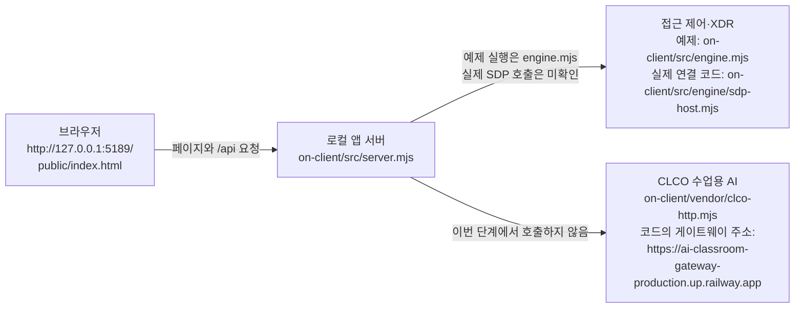

# 케셰브 학생 실행 설명서

이 문서는 학생이 21단계에서 새로 작성한 실행 설명서입니다. 제공 문서(`README.md`, `docs/GETTING_STARTED_STUDENT.md`, `docs/STUDENT_LAUNCH_GUIDE.md`)는 수정하지 않았습니다.

기본 이름은 케셰브입니다. 이 문서는 로컬 예제 실행과 학생 화면이 무엇을 보여 주는지 적습니다. 예제 실행은 접근 제어·XDR 연결, AI 게이트웨이 연결, 보안 조치 집행, OSV 조회 완료가 아닙니다.

## 1. 목적과 기능

직원이 자기 범위의 로그인 상태, 업무 앱 접속 판정, 보안 기록, AI 설명, 조치 상태, 설치 패키지 조회 결과를 브라우저에서 구분해서 봅니다. 학생 코드는 받은 값을 화면에 표시합니다. 판정·기록·조회 요청은 제공 화면과 `on-client/src/server.mjs`가 처리합니다.

## 2. 지원 환경과 버전

| 항목 | 값 | 확인 |
|---|---|---|
| 앱 폴더 | `C:\Users\user\Desktop\choi_bujang-secret-vault\on-client` | 이 PC의 실제 경로 |
| Git 최상위 | `C:\Users\user\Desktop\choi_bujang-secret-vault` | 이 PC의 실제 경로 |
| 앱 버전 | `on-client/package.json`의 `0.2.14` | 파일에서 확인 |
| 수업 기준 Node.js | `24.19.0` (`package.json`의 `engines`) | 파일에서 확인 |
| 이 PC에서 본 Node.js | `v24.19.0` | `node -v` 실행 |
| 이 PC에서 본 npm | `11.17.0` | `npm -v` 실행 |
| 앱의 npm 의존성 | `package.json`에 `dependencies` 없음 | 파일에서 확인 |
| `on-client/package-lock.json` | 없음 | 폴더에서 확인 |
| 운영체제 | Windows, PowerShell | 이 PC |

다른 OS, 다른 Node.js 버전, 포트 변경 실행은 확인하지 않았습니다.

## 3. 폴더

```text
choi_bujang-secret-vault\          Git 최상위
  on-client\                       앱 폴더. PowerShell을 여기서 엽니다.
    package.json                   start, demo, check 스크립트
    student\extension.mjs          학생 화면 함수
    public\index.html              브라우저 화면
    public\app.js                  제공 화면 동작
    src\server.mjs                 로컬 앱 서버
    src\engine.mjs                 예제 접근·기록 자료
    src\engine\sdp-host.mjs        실제 접근 제어 연결 코드. 이번 실행에서는 사용하지 않음
    src\ai\service.mjs             앱 안 AI 호출 코드
    vendor\clco-http.mjs           CLCO 게이트웨이 클라이언트
    tools\start-alekov.ps1         제공 실행 도구. 이번 단계에서 실행하지 않음
    docs\STUDENT_RUNBOOK.md        이 문서
```

## 4. 실행

이미 `http://127.0.0.1:5189/`가 열려 있으면 두 번째 서버를 띄우지 않습니다. 아래는 이번 단계에서 실제로 실행해 본 절차입니다.

1. PowerShell을 엽니다.
2. 앱 폴더로 이동합니다.

```powershell
Set-Location C:\Users\user\Desktop\choi_bujang-secret-vault\on-client
```

3. 예제 서버를 켭니다.

```powershell
npm run demo
```

4. 정상 시작 신호는 콘솔의 다음 한 줄입니다. 이 문구를 이번 단계에서 봤습니다.

```text
케셰브 예제: http://127.0.0.1:5189
```

5. 브라우저에서 `http://127.0.0.1:5189/`를 엽니다. 제목은 `케셰브 · ZTNA & XDR`이고, 탭은 `보호 현황`, `업무 앱`, `보안 기록`입니다. 예제 자료라는 문구가 보입니다. 이 주소는 문서 작성 중 HTTP 200으로 응답했습니다.

`npm run demo`는 `node src/server.mjs --demo`입니다. 예제 엔진은 `on-client/src/engine.mjs`의 자료이며, 실제 접근 제어 서버에 연결된 상태가 아닙니다.

### 코드에는 있고 이번 단계에서 다시 실행하지 않은 명령

| 명령 | 코드상 의미 | 이번 단계 |
|---|---|---|
| `npm start` | `node src/server.mjs`. 콘솔 문구는 `케셰브 연결 확인: http://127.0.0.1:<포트>` | 다시 실행하지 않음 |
| `npm run check` | `student/extension.mjs` 문법만 검사 | 화면 실행 절차가 아님 |
| `powershell -NoProfile -ExecutionPolicy Bypass -File .\tools\start-alekov.ps1` | 제공 도구. 성공 문구는 `케셰브가 켜졌습니다. 브라우저에서 http://127.0.0.1:5189/ 을 여세요.` | 실행하지 않음. 확인 필요 |

포트 기본값은 `5189`입니다. `ON_PORT`는 `on-client/.env.example`에 예시로만 있고, 비밀값은 아닙니다. `.env`에 열쇠·토큰·비밀번호를 넣더라도 이 문서에는 적지 않습니다.

### 종료와 다시 실행

제공 도구 `tools/start-alekov.ps1`은 끄려면 그 창에서 `Ctrl+C`를 누르라고 적습니다. `npm run demo`로 켠 서버도 그 명령을 실행한 PowerShell 창에서 `Ctrl+C`로 끝냅니다. 이번 단계에서는 켜져 있던 예제 서버를 종료하지 않았으므로, 종료 후 다시 실행은 미확인입니다.

## 5. 구성

브라우저가 로컬 앱 서버를 열고, 그 서버가 접근 제어·XDR 자료와 AI 게이트웨이를 각각 호출하는 구조입니다. 이번 예제 실행에서 응답을 확인한 상자는 브라우저와 로컬 앱 서버뿐입니다.



같은 내용을 표로 적습니다.

| 상자 | 파일 또는 주소 | 이번 단계에서 확인한 것 |
|---|---|---|
| 브라우저 | `http://127.0.0.1:5189/` · `on-client/public/index.html` · `on-client/public/app.js` | 페이지가 열리고 HTTP 200 |
| 로컬 앱 서버 | `on-client/src/server.mjs` · `127.0.0.1:5189` | `npm run demo` 시작 문구와 HTTP 200 |
| 접근 제어·XDR | 예제 `on-client/src/engine.mjs`. 실제 연결 코드 `on-client/src/engine/sdp-host.mjs` | 예제 기록 `event-01`만 화면에 보임. 실제 SDP 호출은 미확인 |
| CLCO 수업용 AI | `on-client/src/ai/service.mjs` · `on-client/vendor/clco-http.mjs` · 코드에 적힌 `https://ai-classroom-gateway-production.up.railway.app` | 호출하지 않음. 연결 성공이 아님 |
| OSV | 코드의 조회 주소 `https://api.osv.dev/v1/querybatch` | 예제 조회 결과는 `not_configured`. 외부 조회 완료가 아님 |

학생 화면은 브라우저의 `public/app.js`가 `student/extension.mjs`의 `render` 함수를 호출해 그립니다. 학생 함수는 서버로 조치나 AI 요청을 보내지 않습니다.

## 6. 제공 코드와 학생 코드

제공·학생 경계는 `on-client/.on-starter-manifest.json`의 제공 파일 목록을 기준으로 합니다. 학생 화면 함수는 `on-client/student/extension.mjs`에 있습니다.

| 함수 | 보여주는 것 |
|---|---|
| `renderIdentity` | 현재 계정·기기·세션과 상태 값. `mode`가 `demo`이면 이름·ID를 예시 값으로 적고, 이 PC의 측정 계정이 아니라고 적음 |
| `renderDecision` | 업무 앱 접속 판정 `allow`·`deny`·`challenge`·`unknown`과 요청 실패. `demo` 판정은 예시 값, `checkedAt`은 이번 응답 시각 |
| `renderEvents` | 보안 기록을 거르고 상세를 표시. `demo` 기록은 예시 값이며 이 PC의 실제 보안 기록이 아님 |
| `renderStatus` | 기기·세션 알림과 비밀이 없는 도움정보. `demo` 기기·세션은 예시 값. CPU·메모리·디스크는 제공 필드가 없어 `확인 불가` |
| `renderAiConnection` | AI 연결 점검 전·점검 중·실패·점검 결과. 사건 설명 실행과 구분 |
| `renderExplanation` | 선택 기록의 근거·규칙·`unknown` 상태·조치 제안. 제안은 실행이 아님 |
| `renderAction` | `idle`부터 `succeeded`까지 조치 상태. 접수 응답은 효과 확인이 아님 |
| `renderVulnerabilities` | 패키지 조회 상태. `checkedAt`은 이번 응답 시각이고, `not_configured`는 조회 완료가 아님. 패키지 예시를 만들지 않음 |

제공 화면의 버튼 이름은 그대로입니다. 예: `다시 불러오기`, `설치 패키지 조회`, `패키지 조회 취소`, `AI 설명 요청`, `대상과 조치를 확인했으며 집행합니다`, `원천 결과만 재조회`, `조치 화면 취소`.

## 7. 장애별 확인

문구는 학생 함수나 이번 예제 화면에 있는 문장입니다. 화면에서 본 것과 코드에서 읽은 것을 구분합니다.

| 문구 | 의미 | 확인할 것 | 확인 범위 |
|---|---|---|---|
| `케셰브 예제: http://127.0.0.1:5189` | 예제 서버가 포트를 열었다 | 브라우저 주소가 같은지 본다 | 이번 콘솔에서 확인 |
| `예제 자료` | 예제 데이터이다. 실제 연결 성공이 아니다 | `npm run demo`로 켰는지 본다 | 이번 화면에서 확인 |
| `확인 불가` · `확인 불가(unknown)` | 상태를 확인하지 못했다. 정상이나 허용이 아니다 | 해당 칸의 원래 상태 값을 본다 | 코드와 예제 화면의 기기 `unknown` |
| `요청 실패` | 접속 판정 요청이 실패했다. `deny` 판정이 아니다 | 제공 화면의 오류 코드를 본다 | 코드. 이번 화면에서는 판정 요청을 누르지 않음 |
| `허용되지 않았습니다.` | `unknown` 또는 판정 밖 값이다. 접속 성공이 아니다 | `decision` 값을 본다 | 코드 |
| `기록을 불러오지 못했습니다` | 기록 API가 실패했다 | `다시 불러오기` 후 제공 기록 칸을 본다 | 코드 |
| `표시할 기록이 없습니다` | 받은 목록이 비었다 | 제공 기록 칸과 비교한다 | 코드. 예제에는 `event-01`이 있었음 |
| `AI 연결 점검 전` | 연결 점검을 아직 누르지 않았다 | `AI 연결 점검`은 유료 호출이 될 수 있으므로 임의로 누르지 않는다 | 이번 화면에서 확인 |
| `보안 기록에서 기록을 먼저 고르세요.` | 사건 설명을 아직 붙일 기록이 없다 | 기록의 `AI 설명 요청` 전 상태 | 이번 화면에서 확인 |
| `이 기록에는 원천이 지원하는 조치가 없습니다. … 이것이 정상입니다.` | 지원 조치가 없어 조치 준비 버튼이 없다 | 제공 기록 칸 | 이번 화면에서 확인 |
| `아직 미실행(idle)` | 조치를 실행하지 않았다 | 학생 조치 칸. 집행 버튼을 누르지 않는다 | 이번 화면에서 확인 |
| `조회 전` / `조회 중` | 패키지 조회 전 또는 진행 중. 이전 표가 현재 결과가 아니다 | `설치 패키지 조회` | 이번 화면에서 확인 |
| `조회 준비 미완료(not_configured)` | 조회 대상 프로젝트 설정이 없다 | 제공 칸의 `PROJECT_NOT_CONFIGURED`와 학생 칸의 `checkedAt`이 같은지 본다 | 이번 화면에서 확인. 시각 `2026-11-06T05:20:38.087Z` |
| `조회 실패:` | 조회 요청이 실패했거나 취소됐다. 알려진 항목 없음이 아니다 | `error.code`를 보고 `설치 패키지 조회`로 다시 요청한다 | 코드. 취소 버튼은 응답이 빨라 이번 화면에서 누르지 못함 |
| `아직 조회 안 함(not_checked)` | 승인된 공개 패키지가 없거나 아직 조회하지 않았다 | 패키지 행이 `none_found`로 바뀌지 않는지 본다 | 코드와 모의 입력. 이번 화면 아님 |
| `lock 파일 확인 불가(unverifiable)` | lock 파일을 확인하지 못했다 | 패키지 행을 안전으로 읽지 않는다 | 코드와 모의 입력. 이번 화면 아님 |
| `일부 조회 실패(partial)` | 일부만 조회됐다. 이미 받은 취약점 ID는 남긴다 | 받은 `id`가 표에 있는지 본다 | 모의 입력. 이번 화면 아님 |
| `알려진 항목 없음(none_found)` | 그 조회 범위에서 알려진 항목이 없다. 앱 전체가 안전하다는 뜻이 아니다 | `status`가 `none_found`인지 본다 | 모의 입력. 이번 화면 아님 |

## 8. 확인한 기능과 미확인

### 이번 예제 화면에서 확인

- `npm run demo` 시작 문구와 `http://127.0.0.1:5189/` HTTP 200
- 보호 현황의 예제 계정·기기·세션 학생 칸
- 보안 기록 `event-01`과 지원 조치 없음 안내
- 학생 조치 칸 `아직 미실행(idle)`
- 설치 패키지 조회 후 학생 칸 `조회 준비 미완료(not_configured)`와 제공 칸의 같은 `checkedAt`
- `다시 불러오기` 뒤 조치 칸이 미실행으로 남는 것

### 모의 입력으로만 확인

- 조치 상태별 문장, 효과 확인은 `effectApplied === true`와 관측 시각·`receiptId`가 있을 때만
- 패키지 정확한 버전 표시, `^1.2.0` 범위는 설치 버전 행으로 만들지 않음
- `partial`에서 이미 받은 취약점 ID 유지

### 기다림(UNV) · 미확인

- `tools/start-alekov.ps1` 실행, `Ctrl+C` 종료 후 다시 실행, 새 PowerShell 창에서의 재실행
- `npm start`의 실제 회사 시스템 연결. 기본 실행은 연결 없음이 정상이나, 이번 문서 작성 중 그 명령을 다시 실행하지 않음
- 실제 SDP 접근 제어·XDR 조회와 로그인 승인
- CLCO 게이트웨이 호출, AI 연결 점검, AI 사건 설명 성공
- 조치 준비·사람 확인 후 집행·효과 관측. 예제 기록에는 지원 조치가 없음
- OSV `complete`·`partial`·`not_checked`의 실제 화면. `on-client`에는 `package-lock.json`이 없고, 예제 조회는 `not_configured`
- 패키지 조회 취소와 오류 뒤 재조회의 네트워크 요청
- 21·22단계 원문 제출과 판정 통과

## 9. 예시 값과 이번 PC에서 받은 값

2026-11-06에 원래 폴더 `on-client`의 기존 예제 서버 `http://127.0.0.1:5189/`를 다시 열었습니다. 그 프로세스는 `2026-11-06T05:13:37.862Z`부터 `npm run demo`로 켜져 있었고, 이번 확인에서 HTTP 200이었습니다. 서버를 새로 켜거나 종료하지 않았습니다. 복제 폴더의 5190 서버는 이번 확인 대상이 아닙니다.

| 화면 값 | 구분 | 이번 화면에서 본 내용 |
|---|---|---|
| `practice-user`, `practice-pc`, `practice-session`, `event-01`, `2026-10-12T03:00:00.000Z` | 예시 값 | 학생 칸에 예시 값이라는 문장이 함께 보임 |
| 판정 `거부(deny)`, 이유 `기기 상태를 먼저 확인해야 합니다.` | 예시 값 | `개발 저장소 접속 요청` 한 건. 학생 칸에 실제 접근 제어 서버의 판정이 아니라고 보임 |
| 판정 시각 `2026-11-06T06:15:13.290Z` | 이번 응답에서 받은 값 | 학생 칸에 그 문장이 보임 |
| `조회 준비 미완료(not_configured)`, `checkedAt: 2026-11-06T06:14:49.464Z` | 상태 문구와 이번 응답 시각 | 패키지 행은 없음. `checkedAt`은 취약점 조회 완료가 아님 |
| 조회 전의 `조회 전` | 아직 요청 전 | 이 상태의 입력에는 `mode`가 없어 예시 문장을 붙이지 않음 |

`AI 연결 점검`, `AI 설명 요청`, 조치 집행, `npm start`, `start-alekov.ps1`은 이번에도 실행하지 않았습니다.

## 10. 제공 기기와 읽지 못한 자원

제공 화면의 `내 기기`는 `id`, `label`, `status`만 줍니다. CPU 사용률, 메모리 사용량, 디스크 남은 공간 필드는 없습니다. 학생 `renderStatus`는 그 세 항목을 `확인 불가`로 표시하고, 측정 시각과 단위도 `확인 불가`와 `없음`으로 적습니다. 예시 퍼센트나 용량은 넣지 않습니다. OS를 관리자 권한으로 읽지 않습니다.

이 문장을 넣은 뒤 `http://127.0.0.1:5189/`를 새로고침했습니다. 학생 상태 칸에 자원 세 줄이 모두 `확인 불가`로 보였습니다. 제공 `내 기기`의 `연습 PC`와 `확인 불가(unknown)`는 예시 값입니다.
